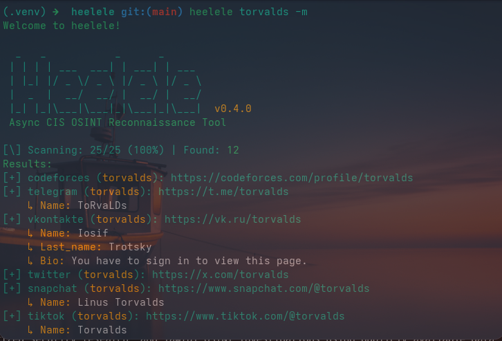
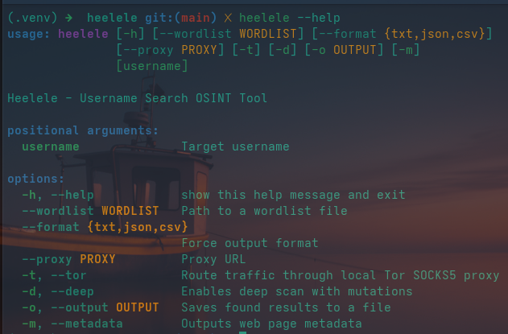

# 🔎 Heelele - Username Search OSINT Tool

Heelele is a flexible, asynchronous, console-based Open Source Intelligence tool with a focus on the CIS space.



## 📃 Summary
*Fast, configurable username reconnaissance across many platforms.*

Heelele instantly checks links with username inside existence on widely visited CIS sites and returns the results.

**Heelele does:**
* Retrieve information via asynchronous HTTP GET requests
* Run on python3
* Work completely silently

## 🛠️ Installation
### With pipx
```bash
pipx install git+https://github.com/trid147/heelele.git
pipx ensurepath
source ~/.bashrc
```

### Updating
```bash
pipx upgrade heelele
```

### With PyPI *(Coming soon)*
```bash
pip3 install heelele
```

### From GitHub
```bash
git clone https://github.com/trid147/heelele.git
```

## 🚀 Quick start
Only Terminal and Python 3.10+ needed to start Heelele.

## 🔰 Command example

### Basic scan
```bash
heelele superdude -m
```

### Deep scan & Export to JSON
```bash
heelele superdude -d -m -o results.json
```

### Scan with Tor
```bash
# Requires active Tor daemon or Tor Browser
heelele superdude --tor
```

### Scan with proxy
```bash
heelele superdude --proxy http://127.0.0.1:8080
```

### Help command
```bash
heelele --help
```



## 📆 Future Roadmap
* [x] Metadata extraction
* [x] Structured output formats
* [x] Proxy & Tor support
* [ ] Avatar hash matching
* [ ] Cyrillic-to-Latin transliteration
* [ ] Phone number module

## ⚠️ Disclaimer
This tool is intended strictly for educational purposes, authorized security research, and lawful OSINT investigations using publicly available data.